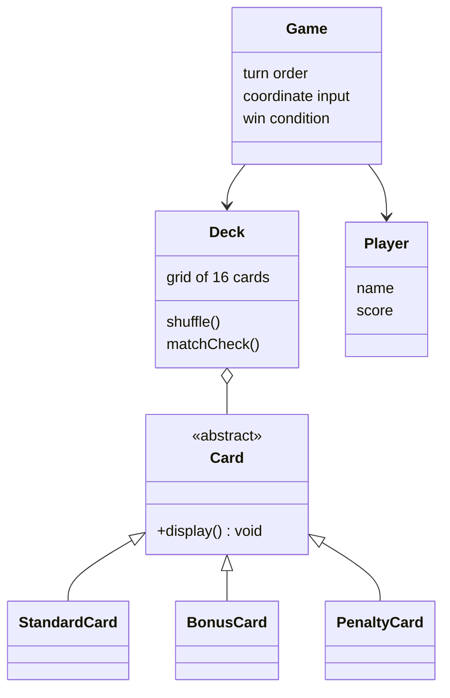

<div align="center">

# Memory Match, a C++ card game

**Two players, a 4x4 grid, and a small class hierarchy built on inheritance and virtual dispatch.**

[](https://github.com/Abdelrahmanshaheen1/Game-of-Memory-Cpp/actions/workflows/build.yml)


[](LICENSE)

</div>

## At a glance

| | |
|---|---|
| **What** | Console memory-matching game: flip two cards per turn by entering grid coordinates, matches stay face up and score |
| **OOP showcase** | Abstract `Card`, three subclasses (`StandardCard`, `BonusCard`, `PenaltyCard`) overriding `display()` |
| **Build** | `g++ -std=c++17 -o memory_match main.cpp` |
| **Test** | `./smoke_test.sh` builds with `-Wall -Wextra -Werror` and AddressSanitizer + UBSan |
| **Dependencies** | None, standard library only |

## Contents

[Class design](#class-design) · [Build and run](#build-and-run) · [Tests](#tests) · [Known limitations](#known-limitations) · [Layout](#repository-layout)

## Class design



## Build and run

```bash
g++ -std=c++17 -o memory_match main.cpp
./memory_match
```

Enter two names, then take turns typing grid coordinates as `x y` (0 to 3) to flip two cards. A match stays revealed and scores, a mismatch flips back. The game ends when every card is matched.

## Tests

`./smoke_test.sh` builds the game with `-Wall -Wextra -Werror` and AddressSanitizer + UBSan, plays four scripted turns and checks that both players get a turn and a match/no-match result is printed. Any warning, memory error or undefined behaviour fails it. The deck is shuffled at random, so a whole game cannot be scripted; this checks the build and the turn loop, not every rule. GitHub Actions runs it on each push.

## Known limitations

- Input is read with plain `cin >> x >> y` and is not validated beyond the 0-3 range check, so typing a non-number (or closing the input stream) makes the prompt loop repeat instead of exiting.
- Shuffling uses `rand()` seeded from the clock, so two games started in the same second get the same layout.

## Repository layout

```text
.
├── main.cpp                 # entry point and the class implementations
├── Game.h  Deck.h  Player.h # game flow and state
├── Card.h  StandardCard.h  BonusCard.h  PenaltyCard.h
├── smoke_test.sh            # sanitizer build + scripted turns
└── .github/workflows/build.yml
```

## License

[MIT](LICENSE) © 2026 Abdelrahman Shaheen
